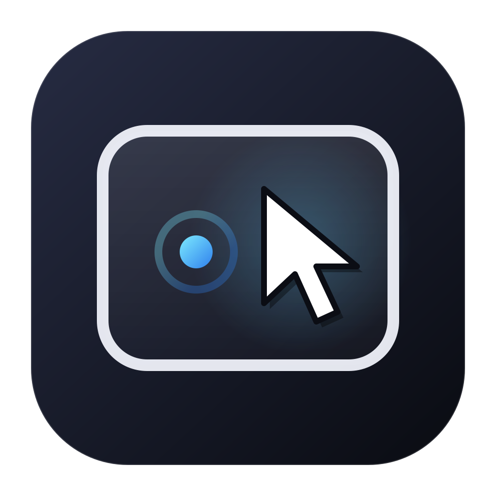

<p align="center">
  
</p>

# TouchScope

TouchScope is a macOS menu bar utility that turns the built-in MacBook trackpad into an absolute pointing surface: your finger position on the trackpad maps directly to the cursor position on screen.

It is not a touchscreen emulator and not Direct Touch. The app reads multitouch data through the private `MultitouchSupport.framework` and moves the system cursor with `CGEvent`. Physical clicks, tap-to-click, and drag remain native macOS behavior.

> Status: prototype `0.1.0`. Uses a private API and ad-hoc signing. Not intended for the Mac App Store; macOS updates may break it.

## Features

- Absolute cursor positioning from the built-in trackpad.
- Native physical clicks and tap-to-click, with no synthetic click events.
- Drag with a 5 pt threshold: a slight movement while pressed stays a click; a deliberate movement becomes a drag.
- Motion smoothing, a sticky retouch zone, and jitter protection.
- Toggle CG mouse with a three-finger double-tap.
- Menu bar-only: no Dock icon and no window.
- Local log at `~/touchscope.log`; no network access or telemetry.

## Requirements

- macOS 15+; tested on macOS 27.0.1 (26A434).
- Swift 6.1 / Xcode with Swift 6.1 support; tested with Xcode 27.1.
- Apple Silicon; not tested on Intel.
- **Accessibility** permission to control the cursor in other applications.

## Build

```sh
cd TouchScope
make app
open .build/app/TouchScope.app
```

`make app` builds the release binary, creates `.build/app/TouchScope.app`, copies the icon, and signs the bundle ad-hoc.

Rebuild and launch immediately:

```sh
cd TouchScope
make run
```

Launch an existing build:

```sh
open .build/app/TouchScope.app
```

Install into `/Applications`:

```sh
ditto .build/app/TouchScope.app /Applications/TouchScope.app
open /Applications/TouchScope.app
```

## First launch

1. After launch, the TouchScope icon appears in the menu bar.
2. Open the menu and choose **Grant Accessibility…**.
3. Enable TouchScope in **System Settings → Privacy & Security → Accessibility**.
4. Return to the menu and enable **CG mouse**.
5. Verify: a finger on the trackpad should move the cursor absolutely, and a physical click should click at the current position.

If the menu shows **Accessibility: Granted**, permission is already granted. If it shows **Global trackpad: Unavailable**, the app could not connect to the built-in trackpad; check `~/touchscope.log`.

## Usage

- **CG mouse** — enable or disable absolute cursor control.
- **3-finger double-tap toggles CG mouse** — two quick three-finger taps toggle the mode; this works even when CG mouse is off.
- **Accessibility** — permission status and a shortcut to System Settings.
- **Quit TouchScope** — shut down cleanly and restore the hardware cursor.

While active:

- Move one finger — the cursor follows the absolute finger position.
- Press the trackpad — a normal click occurs at the current position.
- Press and move more than 5 pt — a drag begins.
- Press and move less than 5 pt — it remains a click.
- Release the finger at the target position to finish the drag.

The screen is selected when CG mouse is enabled: the display under the cursor is used. When switching displays, turn CG mouse off and on again.

## How it works

```text
Trackpad
   ↓
MultitouchSupport.framework
   ↓
MultitouchTouchSource
   ↓
CGMouseController
   ↓
CGEvent → WindowServer → frontmost application
```

- `MultitouchTouchSource` loads the private `MultitouchSupport.framework`, finds the built-in trackpad, reads `MTTouch` frames, and tracks one logical pointer.
- `CGMouseController` maps normalized trackpad coordinates to screen coordinates, disassociates the hardware cursor with `CGAssociateMouseAndMouseCursorPosition(0)`, and posts `mouseMoved` / `leftMouseDragged` events.
- Physical button state is read with `CGEventSource.buttonState`, so clicks and drag remain system-native; the app only helps position the cursor.
- `main.swift` creates the menu bar item and connects the trackpad to the cursor controller.
- `Log.swift` writes a minimal log to `~/touchscope.log`.

## Limitations

- **Private API.** `MultitouchSupport.framework` is not a public contract; macOS updates may break trackpad reading.
- **Accessibility.** CG mouse will not start without permission. Ad-hoc signing is tied to TCC, so the permission may reset after each rebuild; grant it again.
- **Force-kill.** Killing the process without a clean shutdown may leave the hardware cursor disassociated until the next login. Quit through **Quit TouchScope**.
- **Not Direct Touch.** The app does not deliver `NSTouch` to other applications and does not create a virtual touchscreen. A real touchscreen requires the `com.apple.developer.hid.virtual.device` entitlement, which is not available in ordinary provisioning profiles.
- **No pressure, settings, hotkey, or area editor.** The click threshold is fixed at 5 pt, and the only gesture is the three-finger double-tap.
- **No notarization.** When moved to another Mac, Gatekeeper may require opening the app via the context menu → **Open**.

## Project layout

```text
.
├── README.md
├── LICENSE
└── TouchScope/
    ├── Package.swift
    ├── Makefile
    ├── build-app.sh
    ├── AppIcon.svg
    ├── AppIcon.icns
    └── Sources/TouchScope/
        ├── main.swift
        ├── MultitouchTouchSource.swift
        ├── CGMouseController.swift
        └── Log.swift
```

## License

MIT. See [LICENSE](LICENSE).
